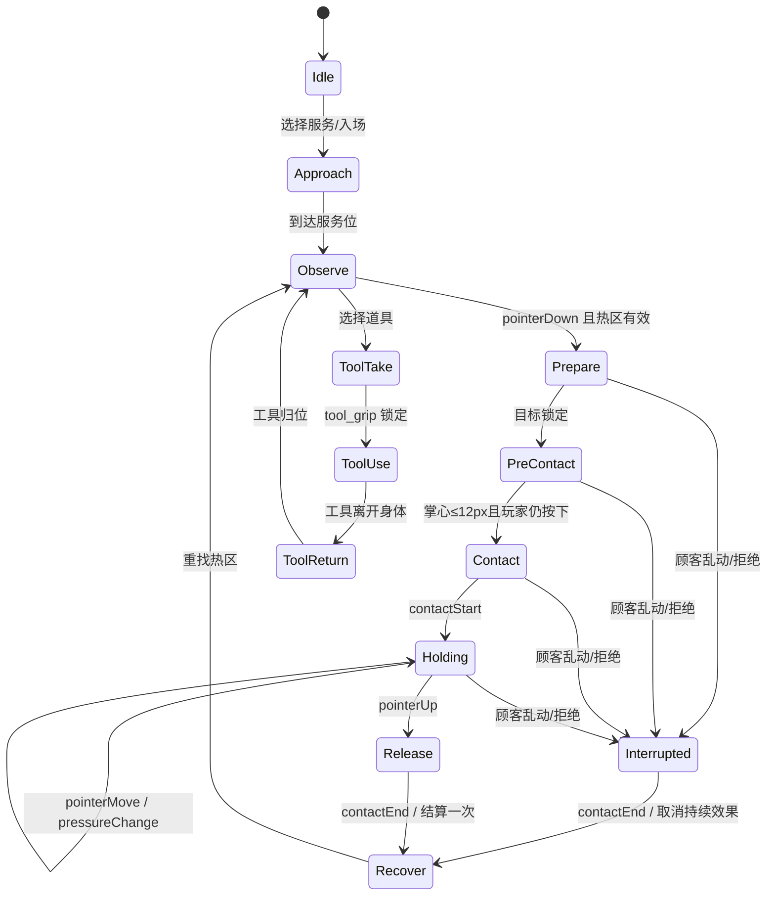

# 分层素材生产、状态机与分阶段验收计划 v1

本文件供美术、动画、程序和 Game Director 按同一交付标准工作。时间与人数均为**假设**，以第一批实际制作时长校准。最终范围固定为 8 名技师、7 类顾客、开背/压腿/足疗三场景；首批只制作 3 名技师＋1 名顾客，批量制作需要首批视觉与互动验收通过。

七类顾客资源规划：吃货 `foodie`、轻柔控 `gentle_fan`、大力控 `strong_fan`、爱玩型 `playful`、挑剔型 `picky`、憨憨型 `easygoing` 六类普通顾客，外加 `tricky` 稀有客。旧动画样机已有这七个配置，但各人的正式分层素材仍不存在。规则引擎原先只有五类普通顾客，本次补上 `picky` 配置；其余 `gentle/strong/flirt/goofy` 是旧规则 ID，需要在批量制作前建立明确映射或统一 ID，关卡池也需逐一校验。当前浏览器样机只使用 `foodie` 一人。

## 1. 风格锁定与第一批资源缺口

已提供概念图给出暖木店铺、厚描边 2D 卡通、较完整人体比例、明显发型/体型差异、文件卡 UI。`art/concepts/` 是整张构图，`art/characters/bao_master_portrait.png` 是单张透明肖像。**目前没有任何一名技师或顾客的完整分层、绑定、表情组件或连续动作帧。** 旧 CSS/Emoji/几何样机只证明状态机，不代表视觉验收。

第一批人物需求（源文件建议 PSD/Krita，导出透明 PNG 或 WebP）：

| 资产 ID | 阿烈 | 芬姨 | 包师傅 | 吃货顾客 |
|---|---|---|---|---|
| 正/侧/背三视图 | 1 套 | 1 套 | 1 套 | 1 套（含趴卧/仰卧/坐卧） |
| 基础骨骼层 | 头、前后发、眼眉口、颈、胸、腰、髋、双上臂/前臂/手、双腿/脚、衣袖/领饰 | 同基础＋围裙/毛巾/短卷发束 | 同基础＋手表/腰巾/右手指节/金光遮罩 | 头、眼眉口、肩、背、躯干、左右腿/脚、被单前后遮挡 |
| 表情 | 中性、观察、得意、吃惊、恼怒、失败至少 6 | 中性、关怀、开心、吃惊、恼怒、失败至少 6 | 中性、专注、得意、蓄力、吃惊、失败至少 6 | 中性、放松、舒服、不适、愤怒、拒绝、震惊 7 |
| 手/工具 | 左右手张开/握持/接触各 3，精油瓶握把锚点 | 左右手张开/托盘/接触各 3，围裙二级运动 | 左右手张开/蓄力/接触各 3，卸表手形 | 背/腿/足的局部受力层、拒绝抬手 |
| 第一批动作 | 共用 9 接口的关键姿势＋飞吻 | 共用 9 接口的关键姿势＋递食物 | 共用 9 接口的关键姿势＋黄金右手 | 7 共用反馈动作＋三姿态局部反应 |

第一批还需 3 场景可交互层：远景、床/椅/盆前后沿、人物遮挡、`back/legs/feet` 热区 alpha mask、接触压痕/油滴/水波/金光 4 组透明特效；毛巾、精油和托盘各有陈列、握持、接触、归位状态。**概念图不经重绘不得直接抠出身体和手臂拼装。**

生产方法：先按概念图做三视图和六姿势剪影；导演签核体型/手掌大小/镜头安全区；再按骨骼层切分、补绘被遮挡区域，绘制手势与脸组件；技术美术设置 pivot、draw order、contact anchor；完成 P0–P5 关键姿势；最后补中间帧和二级运动。单张 AI 概念图可以做参考，不能充当绑定源文件。

## 2. 动画状态机和接触点

双角色共享 `interactionId`，顾客状态受技师接触事件驱动：`anticipate → respondRelax/respondPain → recover`。`contactEnd` 同帧停止顾客的循环反应与持续特效。工具有 `tool_grip`（握持）与 `tool_tip`（接触）两个独立锚点；手掌与工具不得同时被判为同一个接触端。规则适配只在有效动作完成时调用现有 `performService`，特殊技能调用 `useSkill`；质量、金币和拒绝状态以规则返回值为准。

程序分层：`InputMapper`（指针/触控和坐标换算）→ `InteractionDirector`（阶段/事件/中断）→ `RigSolver`（骨骼/IK/脚步补位）→ `GuestDirector`（同步反馈）→ `RuleAdapter`（现有纯规则）→ `Renderer`（分层美术/特效/UI）。浏览器样机可先用 Canvas 2D；正式项目转 Phaser 时只替换渲染适配，不重写角色表演和规则层。正式 TypeScript 构建需 `tsc --noEmit` 严格检查、图集打包和运行性能测量。

**当前第一批样机状态（2026-10-25）**：[可操作入口](../../animation-experience/index.html) 已提供三名技师与吃货顾客、三场景切换、点击/长按/拖动/松手/道具/顾客乱动及规则数值联动。包师傅已接入前期清单中的 19 件可操作道具与食品，另补压腿参考图中的按摩霜，共 20 件，并按场景限制使用；阿烈和芬姨保持较小的专用道具箱。各件有独立的试制 SVG 外形、动作提示及本局次数、冷却、花费和数值修正；动画样机与原可玩关卡共用 [`item-rules.js`](../../massage_mayhem_engine/item-rules.js)。人物为可分层 SVG 试制；入场步态、手臂 IK、局部顾客反馈可审交互因果，不能审正式造型完成度。毛巾展开形变、精油流体、工具接触端独立绑定仍待美术制作。技师开心、愤怒、震惊、失败的完整表演，三场景顾客各姿势补绘、真实脚步和衣料二级运动也待正式资源。**第一批视觉与整体动画体验尚未验收通过**。

## 3. 批次、交付和通过条件

| 批次 | 内容与假设工期 | 每批必须交付 | Game Director 验收门槛 |
|---|---|---|---|
| 0 动作审批 | 2–3 工作日 | 审计、8 人导演表、3 场景矩阵、三张 P0–P5 分镜、素材缺口表 | 角色比例、个性、喜剧节奏和镜头方向获批准；分镜仍不算动画 |
| 1 角色与交互验证 | 8–12 工作日；1 原画＋1 动画/技术美术＋1 前端（假设） | 阿烈、芬姨、包师傅＋吃货顾客分层试制，三场景可操作浏览器样机，点击/长按/拖动/松开/工具/打断均可测 | 角色外形接近已批准概念；六姿势连接自然；手掌接触误差≤12 px；顾客同帧反馈；规则变动可追溯；无整图平移假按摩 |
| 2 常规角色扩量 | 12–18 工作日（假设） | 小曼、老冯、岚姐、阿虎、小周分层素材与可操作浏览器样机，每人专属技能 | 每人站姿、步态、表情和专属动作可辨；同一接口适配不同体型，且不出现手臂穿模/脚滑 |
| 3 顾客扩量 | 10–15 工作日（假设） | 其余 6 类顾客、三姿态和 7 反馈动作；完整 8×7×3 组合抽样样机 | 顾客体型和偏好不被误读；拒绝/投诉能靠动作识别；同帧接触与数值一致 |
| 4 全量打磨 | 5–8 工作日（假设） | 特效、道具、镜头/录屏、性能、横竖屏适配、回归测试 | 30 关素材引用无缺失；PC Web 60 fps 目标、移动 Web 30 fps 下限（假设）；无空白帧或输入丢失 |

验收使用 960×540 基准画面与 390×844 手机视口（假设）。每批附浏览器操作入口、资源清单、关键帧导出、接触点标注、测试录像/截图、已知问题及自动测试结果。检查至少覆盖：快速连点、按住 2 秒、拖过热区边缘、拖出画布、触控取消、顾客随机移位、工具使用中打断、规则终局同时触发。

## 4. 风险与边界

| 风险 | 具体表现 | 控制方法 |
|---|---|---|
| 概念图与可绑素材落差 | 单张图遮挡部分没有被画出 | 分层补绘和三视图签核先于绑定；不给旧单张 PNG 假 pivot |
| 八角色共用过头 | 所有人步态与手形一致 | 统一接口、每人独立动作曲线与关键帧；导演按黑白剪影盲测辨认 |
| IK 超出骨骼可及范围 | 长臂拉伸、肩脱节、脚滑 | 限制手臂长度，必要时脚步补位/躯干转动；不可及目标不计有效接触 |
| 规则与动画不同步 | 收手后顾客继续舒服、数值提前跳 | 共享 interaction ID，接触/释放/中断事件做一次性提交；日志可回放 |
| 视觉方案与性能冲突 | 手机端骨骼层/图集过大 | 首批按 3 人＋1 客实测绘制调用、图集大小和 FPS，再决定压缩与骨骼混合策略 |
| AI 图精度不够 | 六格分镜比例漂移、手指数量错误 | 分镜只用于视觉意图；正式分层图由原画校准、补绘并通过锚点与动画 QA |
